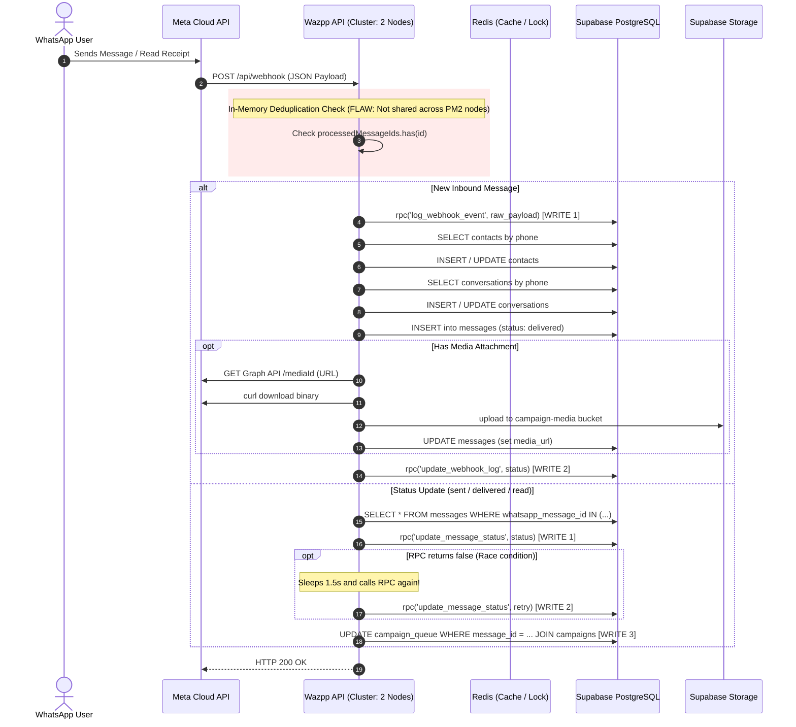

# 03. WhatsApp Webhook, Message Processing & Media Storage Audit

## 1. Webhook Lifecycle & Architecture Overview

The WhatsApp webhook pipeline handles high-volume real-time events sent by Meta's Cloud API:
1. Inbound messages (text, media, location, interactive responses).
2. Outbound message status updates (`sent`, `delivered`, `read`, `failed`).
3. Flow responses and coexistence synchronization.

---

## 2. Message Lifecycle Flow Diagram



---

## 3. Webhook Deduplication & Concurrency Audit

### 3.1 In-Memory Deduplication Vulnerability (P0)
- **Source File & Lines:** [`wazpp-server/routes/webhook.js:75-80`](file:///e:/code-from-haris/Wazpp/new/wazpp-server/routes/webhook.js#L75-L80), [`838-842`](file:///e:/code-from-haris/Wazpp/new/wazpp-server/routes/webhook.js#L838-L842), and [`1268-1272`](file:///e:/code-from-haris/Wazpp/new/wazpp-server/routes/webhook.js#L1268-L1272).
- **Code:**
  ```javascript
  // Deduplication Cache (Simple In-Memory)
  const processedMessageIds = new Set();
  // Clear cache every 10 minutes
  setInterval(() => {
      processedMessageIds.clear();
  }, 10 * 60 * 1000);
  ```
- **Identified Defects:**
  1. **Zero Cross-Process Synchronization:** The deduplication cache is a local in-memory JavaScript `Set`. Because `ecosystem.config.js` runs **2 cluster instances** (`wazpp-api-0` and `wazpp-api-1`), each instance maintains an independent `Set`. When Meta delivers webhooks load-balanced across the cluster, or retries upon network jitter, Node 1 does not know what Node 0 processed.
  2. **Total Purge Every 10 Minutes:** At minute 10, the entire `Set` is cleared. Any delayed webhook delivery from Meta arriving after 10 minutes will be reprocessed as a new message, repeating database contact lookups, conversation updates, and message inserts.
  3. **Lack of Database Atomic Guard:** While `messages` has an `upsert` with `onConflict: 'whatsapp_message_id'` in the coexistence loop (line 852), standard inbound message processing uses `.insert(insertPayload)` (line 1550). If a duplicate slips past the in-memory set, it attempts a duplicate insert or errors.
- **Recommended Remediation:**
  - Use Redis with atomic `SET message_dedup:<id> 1 NX EX 86400` (24-hour expiration) across all PM2 cluster nodes.
  - Rely on a PostgreSQL unique constraint on `messages(whatsapp_message_id)` to guarantee database-level idempotency without write amplification.

---

## 4. Webhook Status Update Write Churn (P0)

### 4.1 Telemetry Evidence
From `Findings.md`:
- `public.update_message_status`: **roughly 182,000 calls**, writing **48 MiB** of shared blocks.
- `public.log_outbound_message`: **~98,000 calls**, writing **92 MiB** of shared blocks and **2.28 GiB** of dirtied blocks.

### 4.2 Root Cause Analysis in Code
In [`wazpp-server/routes/webhook.js:863-950`](file:///e:/code-from-haris/Wazpp/new/wazpp-server/routes/webhook.js#L863-L950) and [`lines 1165-1188`](file:///e:/code-from-haris/Wazpp/new/wazpp-server/routes/webhook.js#L1165-L1188):
1. **Unbatched Status Updates:** Even though Meta sends statuses in an array `statuses`, the webhook iterates sequentially over each status and calls `rpcAsService('update_message_status', ...)` individually (Line 900).
2. **Race Condition Double Execution:** If the RPC returns `false` (which occurs frequently because Meta delivers the status webhook before the worker completes inserting the outbound message), the webhook sleeps 1.5 seconds and calls `rpcAsService('update_message_status', ...)` a second time (Lines 911–917).
3. **Unconditional `campaign_queue` Updates:** Lines 1182–1187 execute:
   ```javascript
   const { data: queueRows, error: campError } = await supabaseAdmin
       .from('campaign_queue')
       .update(updatePayload)
       .eq('message_id', waMessageId)
       .select('campaign_id, campaigns (title, template_name)');
   ```
   Every status update (e.g., standard customer 1-on-1 replies) issues an `UPDATE` statement against `campaign_queue`. For non-campaign messages, this scans `campaign_queue` and returns zero rows, generating useless database work.

---

## 5. Webhook Logs Bloat & Retention Gap (P1)

### 5.1 Telemetry Evidence
From the database table size metrics:
- Table: `public.webhook_logs`
- Total Size: **103 MB** (Data: 60 MB, Indexes: 43 MB, ~43,076 rows).
- Telemetry writes: `log_webhook_event` wrote **48 MiB**; `update_webhook_log` wrote **54 MiB**.

### 5.2 Root Cause Analysis
For **every single incoming webhook**, the system performs **two synchronous writes** to `webhook_logs`:
1. Line 19 of incoming webhook: calls `log_webhook_event` inserting the full raw JSON payload.
2. Line 1228 / exit points: calls `update_webhook_log` updating the row's `processed_status`.
3. **Missing Data Retention:** There is no scheduled cron job, partition, or rolling window cleanup for `webhook_logs`. The table has grown to 103 MB. Every new insert and update dirties index and heap pages that must be maintained by autovacuum, creating persistent background I/O.

---

## 6. WhatsApp Media & Supabase Storage Egress Spike (P1)

### 6.1 Telemetry Correlation
- The user's Supabase Dashboard shows **Cached Egress peaking at 15.811 GB on October 22, 2026**, with sustained daily egress between **6 GB and 12 GB**.
- Relation: `storage.objects` has **3,037 rows** and a total size of **7,176 kB**.

### 6.2 Code Analysis of Media Ingestion & Delivery
1. **Inbound WhatsApp Media:**
   - Handled in [`wazpp-server/routes/webhook.js:205-260`](file:///e:/code-from-haris/Wazpp/new/wazpp-server/routes/webhook.js#L205-L260).
   - Inbound audio, video, images, and documents are downloaded from Meta's CDN via `curl` and uploaded to Supabase Storage bucket `campaign-media`.
   - **Cache Control Inconsistency:** In line 247:
     ```javascript
     const { error: uploadError } = await supabaseAdmin.storage
         .from(bucketName)
         .upload(storagePath, buffer, {
             contentType: mimeType,
             cacheControl: '3600', // ← ONLY 1 HOUR!
             upsert: false
         });
     ```
     Setting `cacheControl: '3600'` (1 hour) means CDN caches expire in 60 minutes. Every time users or staff reopen the inbox or reload media, requests bypass or re-validate against Supabase Storage, driving up egress traffic and database metadata checks on `storage.objects`.
2. **Outbound Campaign Media:**
   - In [`routes/upload.js:77`](file:///e:/code-from-haris/Wazpp/new/wazpp-server/routes/upload.js#L77), campaign media is uploaded with `cacheControl: '31536000'` (1 year).
   - When a broadcast campaign is sent to 10,000+ recipients with video or high-res images, Meta's servers fetch the media binary directly from `https://<supabase-url>/storage/v1/object/public/campaign-media/...`.
   - A single 10 MB video sent in a campaign can generate tens of gigabytes of network egress as Meta CDN nodes across global regions fetch and cache the media file.
   - **Important Distinction:** Egress traffic is served from the Storage CDN layer and does **not** directly consume PostgreSQL Disk I/O budget unless media downloads trigger repetitive metadata queries on `storage.objects` or upload churn.
